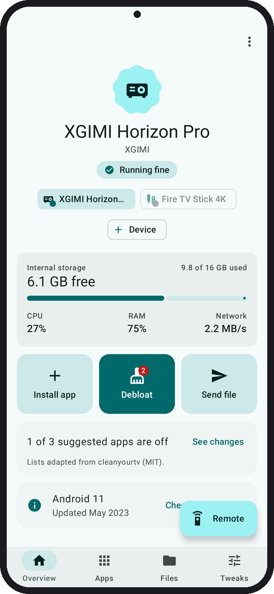
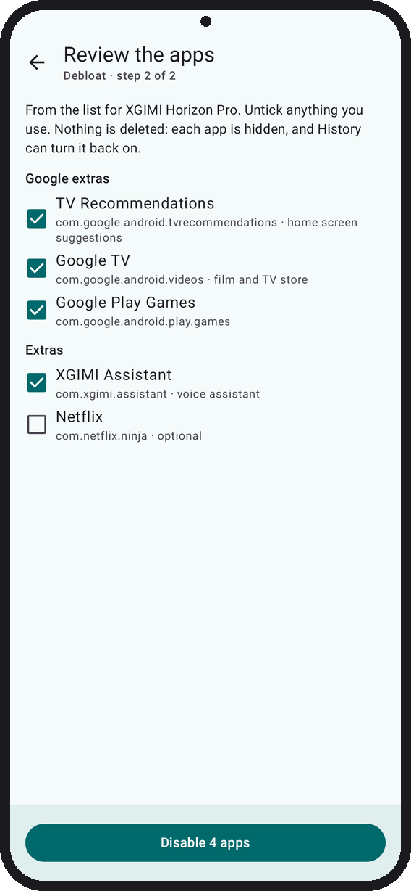
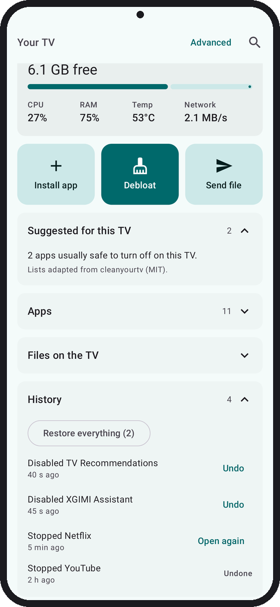
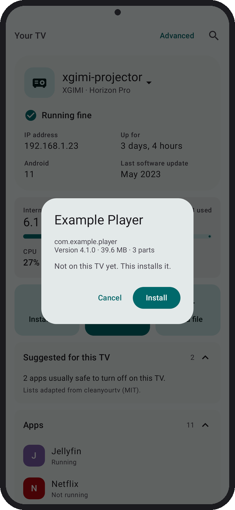

#  Tellyscope

Debloat your Android TV, install apps, and browse and transfer files on it, all from your phone. No root, no PC.

<p>
  
  
  
  
  <a href="../../releases/latest"></a>
</p>

<a href="../../releases/latest"></a>

Or get updates automatically with [Obtainium](#get-it).


<sub>A TV after Tellyscope: only the inputs and your own apps.</sub>

<table>
  <tr>
    <td width="25%"></td>
    <td width="25%"></td>
    <td width="25%"></td>
    <td width="25%"></td>
  </tr>
  <tr>
    <td align="center"><sub>A short welcome on first launch</sub></td>
    <td align="center"><sub>Add your TV step by step</sub></td>
    <td align="center"><sub>Check the key, then Allow</sub></td>
    <td align="center"><sub>Your TV at a glance</sub></td>
  </tr>
  <tr>
    <td></td>
    <td></td>
    <td></td>
    <td></td>
  </tr>
  <tr>
    <td align="center"><sub>Review every app Debloat turns off</sub></td>
    <td align="center"><sub>Undo anything from History</sub></td>
    <td align="center"><sub>Install or update apps</sub></td>
    <td align="center"><sub>Send files to the TV</sub></td>
  </tr>
  <tr>
    <td></td>
    <td></td>
    <td></td>
    <td></td>
  </tr>
  <tr>
    <td align="center"><sub>Browse and save the TV's files</sub></td>
    <td align="center"><sub>Block ads and tweak the TV</sub></td>
    <td align="center"><sub>Answer connection requests</sub></td>
    <td align="center"><sub>Switch the home screen</sub></td>
  </tr>
</table>

<sub>Rendered from the app's screenshot tests with sample data.</sub>

## Get it

- **GitHub Releases.** Download `Tellyscope-<version>.apk` from the [Releases](../../releases) page and open it on your phone. You may need to allow installs from your browser or file manager first. Pre-releases marked `-alpha` are test builds: they install as a separate app next to the regular one, with the same name and icon.
- **Obtainium.** To get updates automatically, add this repository's GitHub address in [Obtainium](https://github.com/ImranR98/Obtainium). Turn on **Include prereleases** only if you want the alpha builds.

Tellyscope needs a phone on Android 8.0 or newer, on the same Wi-Fi as the TV, and a TV with developer options turned on ([how](#setting-up-your-tv)).

## Is it safe?

- **Small and private.** Under 3 MB. No ads, no tracking, no accounts. It makes two internet requests: one fetches the debloat lists from this project's GitHub, or from your own fork if you point it there; the other asks GitHub every 30 minutes whether a newer version is out, and you can turn it off in Settings. Everything else stays on your Wi-Fi, except one lookup: the scan asks your phone's DNS server for the name of each TV it finds, which leaves your Wi-Fi only if that server is outside it, such as Private DNS on the phone. Turning on Private DNS changes where the *TV* looks up addresses, not what the app sends.
- **Reversible.** Apps that came with the TV are only ever disabled, never uninstalled, so nothing is deleted. Apps you installed yourself can also be uninstalled, after a confirm that says it can't be undone. Every change goes into History, all but Uninstall with an Undo, and **Restore everything** turns back on all it turned off.
- **Protected list.** Apps the TV needs to start, update, stay on Wi-Fi, show its home screen or take input can't be stopped or disabled. They sit in their own **System** section under Apps. There is no override. Apps a TV's list only says to keep can still be changed, after a warning in the confirm.
- **You see it first.** Debloat shows every app it will turn off, and the confirm names each one before anything runs.

The full rules are under [Safety rules](#safety-rules).

## What it does

Tellyscope is a phone app that talks to your Android TV, Google TV or Fire TV over the network using ADB, the same debugging protocol developers use.

- **Find and connect.** It looks for TVs on your Wi-Fi, or you add one by IP address. Classic network debugging (port 5555) and Android 11+ wireless debugging with a 6-digit pairing code both work. **Add your TV** walks through turning debugging on one step at a time, with the menu names for Google TV, Android TV, Fire TV, Xiaomi or XGIMI, and general steps for any other TV, then lists the TVs it found. Each TV opens its own screen: the pairing code, or the Allow box with this phone's key to check against the one the TV shows. The first launch opens a short welcome with the three setup steps, and on Android 17 or newer asks for the local-network permission it needs to reach the TV.
- **Remembers your TVs.** They reconnect on their own after a restart of the app or the TV. You can rename a TV (the name stays on your phone) or forget it. The **⋮** menu shows which TV it's for on top, then this TV's items and the app's in two blocks.
- **How it's doing.** Every tab of a TV's page opens with the TV itself: its name, maker and model, and a one-line summary such as "Running fine" or "Storage almost full". Scroll, and its icon and name shrink and slide up into the top bar, where a Connected or Offline badge joins them. On Overview, below that is a chip per TV to switch between them, then a **+ Device** chip. Then comes free space as a bar, with CPU, RAM, temperature and network speed. When a TV is offline, it shows the storage from the last time Tellyscope saw it. Its address and how long it's been on are under Advanced.
- **The main jobs up front.** Big **Install app**, **Debloat** and **Send file** tiles sit right under the vitals. Debloat shows a count while the TV's list still has apps on, or while apps Tellyscope turned off are back on, often after a TV update. When there's nothing left, it opens Apps instead. Under **Suggested for this TV**, one line says how many of the list's apps are off. If any came back on, a red line says so. Below that are the TV's Android version, when it last updated, and **Check for updates**, which opens the TV's own update screen. The Apps tab has an **Install app** button, and Files has **Upload files**.
- **Advanced.** Every number in one place: memory, storage, CPU, temperature, uptime and screen state, CPU and RAM by app, processes, network and data used, and the TV's address.
- **Apps.** Every app on the TV with its real name and icon, under three buttons: **Running** (what's using memory now), **Installed** (only the apps you put on the TV) and **Built-in** (what came with it). The buttons stay pinned under the bar as you scroll. Stop, disable or turn back on any app that isn't protected; each button says what it will do and asks first. Apps you installed yourself also offer **Uninstall**, which asks in a dialog that names the app and says it can't be undone. On Running and Built-in, the protected apps sit last under **System**, which folds away with a tap and stays folded until you open it again. **Search apps** sits under the buttons and pins with them. Tap it and the field moves to the top, the TV and the buttons step aside, and every matching app shows in one list. ← or Back brings them back.
- **Another home screen.** With a second launcher such as Projectivy installed, its row in Apps offers **Set as default launcher**. Tellyscope makes it Home, checks that Home really opens it, and only then disables the old launcher, so the TV can't switch back by itself. The one exception: a stock launcher that outranks the rest, e.g. Android TV Home, is turned off first and turned back on if Home still doesn't open the new one. One Undo in History turns the old launcher back on and makes it Home again. Later, the new launcher's row offers **Switch home back to** the one it replaced, or the TV's own if there was no switch: it's turned back on if it's off and made Home, and the added launcher stays, free to uninstall. Settings and other apps that only answer Home as a fallback are never offered as launchers. On Google TV, the Apps row and the Live tab are part of the old launcher and go with it.
- **Debloat.** It finds your TV among 230+ tested clean-up lists (adapted from [cleanyourtv](https://github.com/Gathin23/cleanyourtv)) and opens on every app it will turn off, with the model on top. With no list for the model, it shows apps from the maker's other lists, none ticked. With none for the maker either, you tick the TV's own apps by hand; the ones it needs aren't shown. **Not this TV?** searches every list. Your pick is remembered, and the TV's page then says how many of the list's apps are still on. Apps are pre-ticked only when the TV runs the Android version the list was tested on; untick anything you use, and you confirm before anything is disabled. If you'd rather not trust our lists, point the app at your own fork of them under **Advanced** in Settings (see [CONTRIBUTING](CONTRIBUTING.md#using-your-own-lists)).
- **History.** Every change is listed with an Undo, and **Restore everything** turns back on what Tellyscope turned off. Undoing a **Turn on** asks first, since it disables the app again. History is kept per TV, across restarts.
- **Install apps.** Pick an APK, several split APKs or an `.apks`/`.xapk`/`.apkm` bundle on your phone. Before installing, Tellyscope shows the app's name, version and size and says whether it's new, an update, a reinstall or an older version. It won't install an older version over a newer one unless you tick the box. If the TV refuses, you get the reason in plain words.
- **TV tweaks.** **Block ads with Private DNS** sends the TV's address lookups to an ad-blocking DNS provider (AdGuard by default, or any other you type in). Tellyscope then checks the TV can still look addresses up, and puts the old setting back if not. It needs Android 9 or newer. **Faster animations** makes menus move at twice the speed. Both land in History with an Undo. **Clear caches** frees space by clearing every app's temporary files; app data and sign-ins stay. **Take screenshot** saves what the TV shows to your phone.
- **Connection requests.** When another device asks to debug the TV, Tellyscope shows the TV's "Allow debugging?" prompt on your phone, with the device's key fingerprint, so you can **Allow** or **Deny** it without the remote. **Always allow this device** appears when the TV's own prompt offers it.
- **Files.** Send a file from your phone into the TV's Download or Movies folder, or save one from there to your phone. Two buttons under the TV pick the folder, and stay pinned under the bar as you scroll. An empty folder says so in the middle of the page. A file with the same name gets a " (1)" instead of being overwritten, and a cancelled copy leaves nothing half-written behind.

## Setting up your TV

1. On the TV, open **About** in Settings and press OK on **Build** (Fire TV: your device's name) 7 times, until it says you're a developer.
2. In **Developer options**, turn on **USB debugging** (Fire TV: **ADB debugging**), and **Network debugging** if your TV lists it. Newer TVs may show **Wireless debugging** instead; turn that on too.
3. Put your phone on the same Wi-Fi as the TV and open Tellyscope. Pick your TV's brand under **Add your TV**, and tap **Connect** when your TV shows up under **Find your TV**.
4. The TV asks "Allow USB debugging?". Check its key matches the one Tellyscope shows, tick **Always allow from this computer**, then press **Allow**. With wireless debugging, Tellyscope asks for the 6-digit pairing code the TV shows instead.

The menu paths differ by brand; the app shows the exact steps for yours.

## Safety rules

Debloating a TV can break it if done carelessly. Tellyscope is built around these rules, and contributions must keep them:

1. **Disable what came with the TV, never uninstall it.** Tellyscope uses `pm disable-user`, which is reversible from the app or with `pm enable`. Uninstall is offered only for apps `pm list packages -3` lists as installed by the user, and runs plain `pm uninstall` after a confirm that says it can't be undone. Tellyscope never runs `pm uninstall --user 0`, the form that removes a TV's own apps.
2. **Record before changing.** Before the first change on a TV, Tellyscope notes which apps were already off, so **Restore everything** turns back on only what Tellyscope turned off. Every change goes into the TV's history with an Undo. The history lives on the phone and is deleted if you uninstall Tellyscope; a disabled app still shows in the Apps list with **Turn on**.
3. **Protected list.** Packages the TV needs to boot, install its updates, stay on Wi-Fi, show web pages, show the home screen or accept input are on a protected list. Tellyscope refuses to stop or disable them, and there is no override in the app. A TV's list can add keeps: those only warn in the confirm, and can be overridden. If the TV doesn't say which app is its home screen, Tellyscope refuses to stop or disable anything. The one exception is switching home screens: the old launcher is disabled only after another launcher has become Home and Home has been checked to open it; a stock launcher that outranks the rest, such as Android TV Home, is turned off first and turned back on if Home still doesn't open the new one. The current home screen itself never can be. A TV's suggested list never protects fewer apps; its keeps add a warning, not a lock.
4. **No root, no exploits.** Only what ADB allows on a stock TV.
5. **Nothing left on the TV.** To show real app names and icons, Tellyscope copies a small helper to `/data/local/tmp`, runs it once and deletes it. The helper only reads through PackageManager: no writes, no permissions, no network.

## Project layout

| Module | What it is |
|---|---|
| `:app` | The Android phone app. Kotlin, Jetpack Compose, Material 3 Expressive. Package `app.tellyscope`. |
| `:adb` | Pure Kotlin/JVM library on top of [Kadb](https://github.com/flyfishxu/Kadb): connecting, pairing and running commands on a TV. Unit-testable without a device. |
| `app/src/helper` | The label helper: plain Java, built into a dex in the app's assets and run on the TV with `app_process`. |
| `:cli` | Desktop smoke test for `:adb` against a real TV (`./gradlew :cli:run --args="stats <tv-ip>"`). Not shipped. |

## Building

Requirements:

- **JDK 25.** Kadb ships Java 25 bytecode, so `:adb` tests need a Java 25 runtime. `:adb` itself still compiles to Java 17 bytecode so the app can use it.
- **Android SDK** with platform 37. Set `ANDROID_HOME` or put `sdk.dir=...` in `local.properties`.

```sh
./gradlew build          # assemble, unit tests and lint
./gradlew :app:installDebug
```

The app supports phones on Android 8.0 (API 26) and newer.

## Contributing

See [CONTRIBUTING.md](CONTRIBUTING.md). If you have an Android TV, a [device report](../../issues/new?template=device_report.yml) helps even if nothing worked.

## Why the name?

Tellyscope is named after Wallace's [Tellyscope](https://wallaceandgromit.fandom.com/wiki/The_Tellyscope), a contraption for changing the channel without getting up. This one is a bit safer.

## License

Tellyscope is licensed under the [GNU General Public License v3.0](LICENSE). Third-party credits are in [NOTICE](NOTICE).
