#  Tellyscope

Debloat your Android TV, install apps, and browse and transfer files on it, all from your phone. No root, no PC.

<p>
  
  
  
  
  
  <a href="../../releases/latest"></a>
</p>

<a href="../../releases/latest"></a>
<a href="https://apps.obtainium.imranr.dev/redirect?r=obtainium://add/https://github.com/man15h/tellyscope"></a>
<a href="https://rookieenough.github.io/Orion-Data/redirect.html?id=tellyscope&icon=https%3A%2F%2Fraw.githubusercontent.com%2Fman15h%2Ftellyscope%2Fmain%2Fdocs%2Flogo%2Ficon.svg"></a>

**Google Play (testing)**

Tellyscope is in closed testing on Google Play. Join the testers group, accept the test, then install it from Play. Play keeps this build updated, so it has no in-app update check, and it doesn't download launchers from GitHub or VLC from VideoLAN.

<a href="https://play.google.com/store/apps/details?id=app.tellyscope"></a>

1\. [Join the group](https://groups.google.com/g/tellyscope-testers) → 2. [Accept the test](https://play.google.com/apps/testing/app.tellyscope) → 3. [Install from Play](https://play.google.com/store/apps/details?id=app.tellyscope)

[](https://youtu.be/N_PeDw5GiCc)

<table>
  <tr>
    <td width="25%">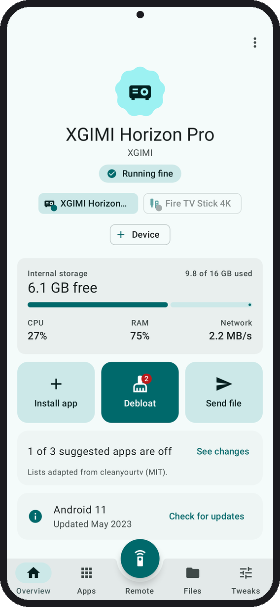</td>
    <td width="25%">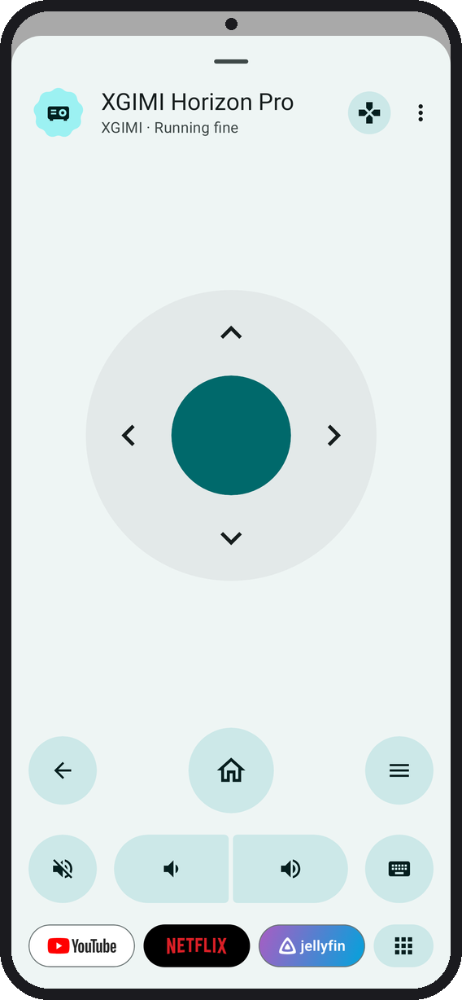</td>
    <td width="25%">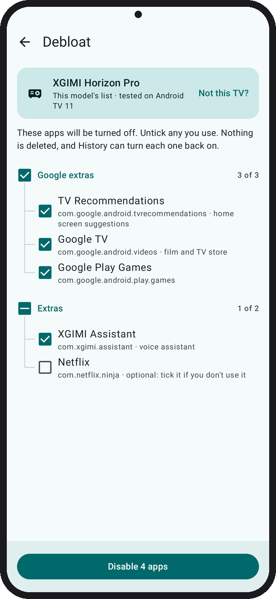</td>
    <td width="25%">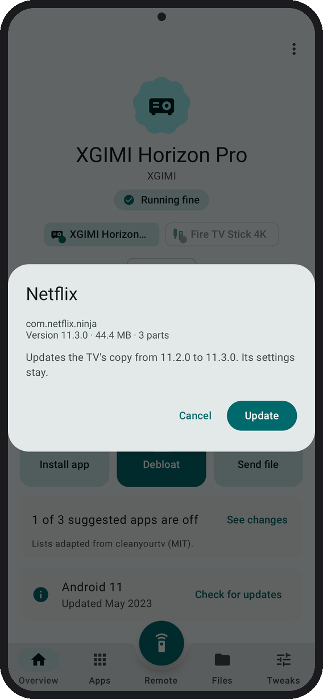</td>
  </tr>
  <tr>
    <td align="center"><sub>Your TV at a glance</sub></td>
    <td align="center"><sub>Control the TV from your phone</sub></td>
    <td align="center"><sub>See every app before it's turned off</sub></td>
    <td align="center"><sub>Install apps</sub></td>
  </tr>
  <tr>
    <td>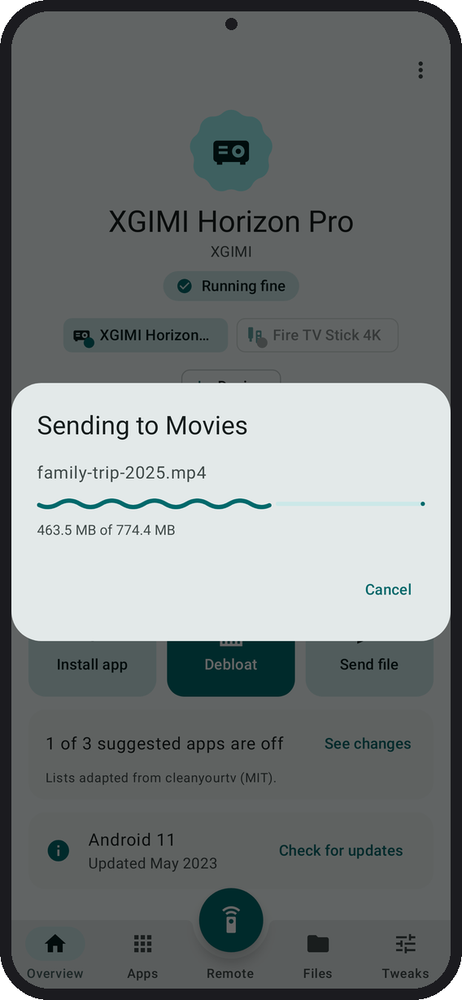</td>
    <td>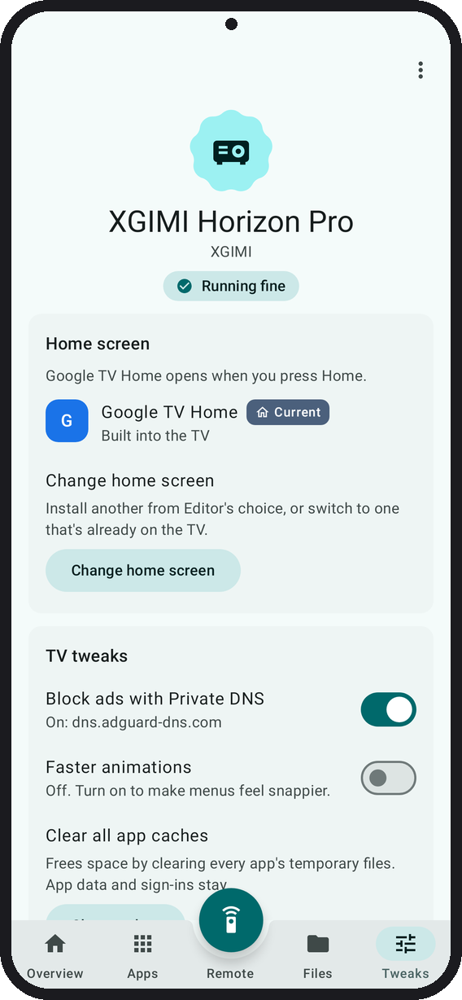</td>
    <td>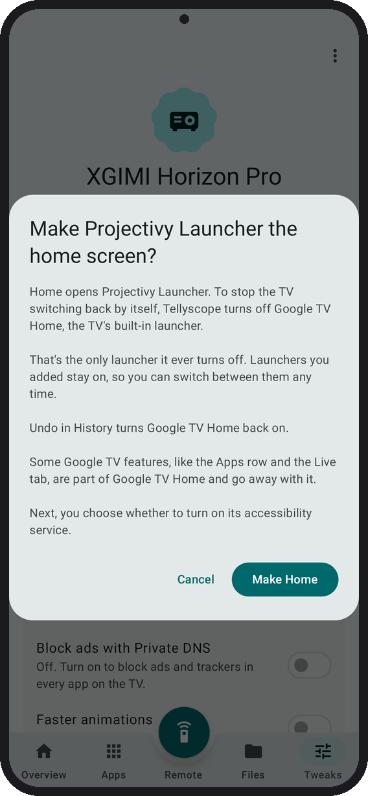</td>
    <td>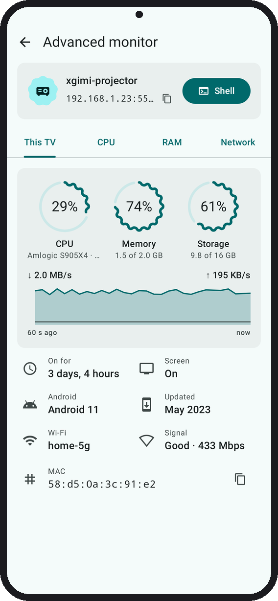</td>
  </tr>
  <tr>
    <td align="center"><sub>Send files to the TV</sub></td>
    <td align="center"><sub>Block ads, tweak the TV, add a launcher</sub></td>
    <td align="center"><sub>Change the home screen</sub></td>
    <td align="center"><sub>The TV in detail</sub></td>
  </tr>
  <tr>
    <td>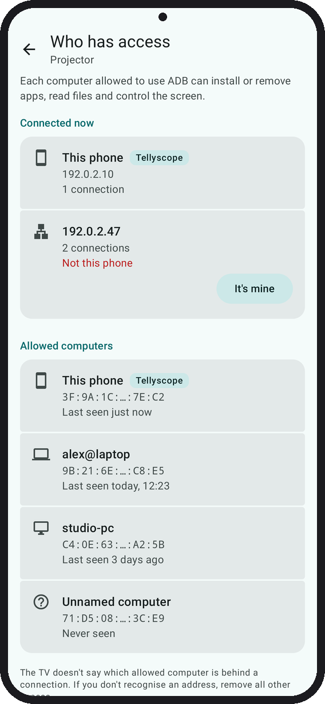</td>
    <td>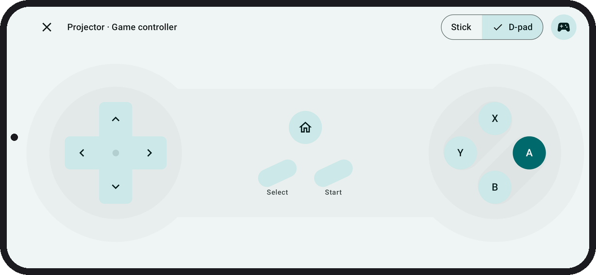</td>
    <td>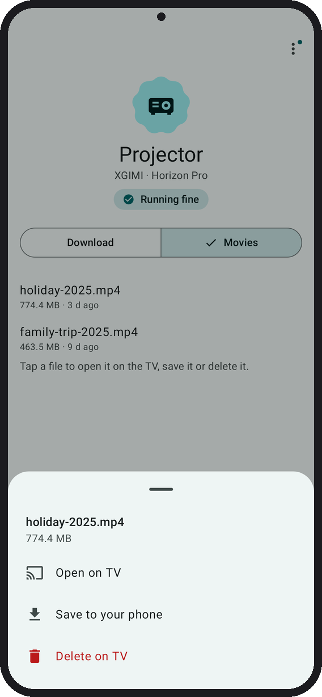</td>
    <td>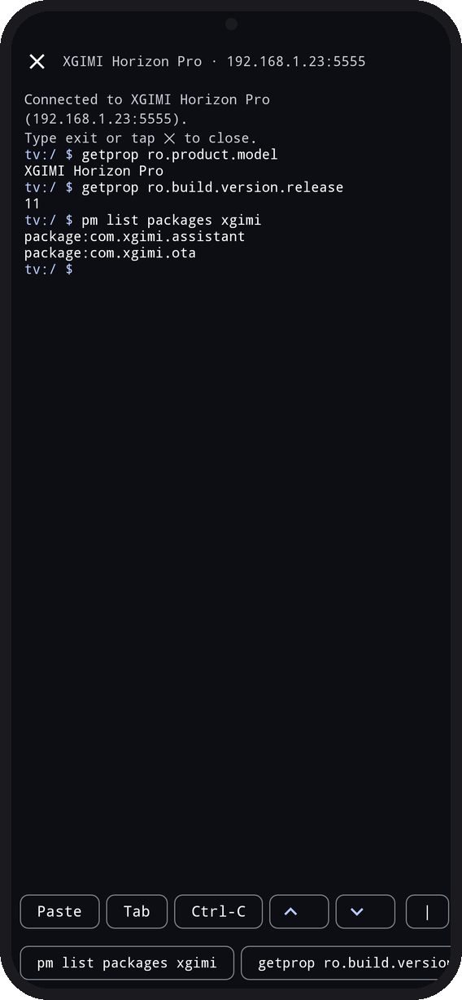</td>
  </tr>
  <tr>
    <td align="center"><sub>See who can reach your TV</sub></td>
    <td align="center"><sub>Play games with your phone</sub></td>
    <td align="center"><sub>Open, save or delete the TV's files</sub></td>
    <td align="center"><sub>A shell on the TV</sub></td>
  </tr>
</table>

<sub>Rendered from the app's screenshot tests with sample data. The Install dialog is drawn to match the app.</sub>

## What it does

Tellyscope talks to your Android TV, Google TV, NVIDIA Shield or Fire TV over Wi-Fi using ADB, the debugging protocol developers use. Tested on Fire TV (Fire OS 8); over HDMI its volume is fixed, so mute and volume are grayed out there. NVIDIA Shield hasn't been tested on real hardware yet.

- Find the TVs on your Wi-Fi, looking again every 10 seconds or when you tap **Rescan**, or add one by its IP address. It works with network debugging, and with Android 11+ wireless debugging and its pairing code.
- Keep several TVs on one phone, rename them or forget one. They reconnect by themselves.
- See the TV's free space, CPU, memory and network speed, and what's paired with it or plugged in.
- See which apps use the CPU, memory and network, with their processes, connections and the data each has used.
- Turn off the apps your TV came with, and turn them back on any time. Tellyscope matches your TV to one of 330+ tested lists (adapted from [cleanyourtv](https://github.com/Gathin23/cleanyourtv), kept in [tellyscope-devices](../../../tellyscope-devices)) and shows every app it will turn off before it does. If turning an app off breaks something else, Tellyscope says what before you do it.
- Untick the apps you use, or a whole group from its heading, and it can stop suggesting them. No list for your model? Pick from the maker's lists, or choose apps by hand.
- Use your own debloat lists instead, from a copy of tellyscope-devices.
- See what's running and what's on the TV, search for an app, and open or stop it.
- Uninstall the apps you added yourself.
- Install apps that aren't in your TV's store, from an APK, split APKs or an `.apks`/`.xapk`/`.apkm` bundle on your phone. It says first whether it's new, an update or an older version.
- Open the TV's Play Store, or the Appstore on Fire TV, to get apps and app updates.
- Put a different home screen on the TV (Projectivy, FLauncher, AT4K or Monet) and switch back to the TV's own any time. Only the TV's own launcher is ever turned off, and a launcher's accessibility service turns on only if you say yes.
- Android TV gets a launcher from its Play Store, or straight from its developer's GitHub releases after a warning (FLauncher from a community fork that keeps it updated). Fire TV has no Play Store, so Tellyscope downloads Projectivy from its developer's GitHub releases. The Play Store build of Tellyscope downloads nothing from GitHub: on Fire TV you download Projectivy in the TV's browser and pick the file. Signatures: see [what the lists can't do](#the-shared-lists).
- Send files to the TV's Download and Movies folders, and save files from there to your phone.
- Play videos, music and pictures from those folders on the TV, in a gallery or a browser when that's all the TV has. If nothing on the TV can open a file, Tellyscope offers VLC from the TV's Play Store, or the Appstore on a Fire TV, and in the GitHub build also from VideoLAN after a warning. Only a VLC signed by VideoLAN is installed.
- Use your phone as a remote: D-pad or touchpad, Back, Home, Menu, mute and volume, and type on the TV with your phone's keyboard. It can vibrate on each key.
- Use your phone as a mouse pointer on the TV (drag to move, tap to click, two fingers to scroll), or turn it sideways as a game controller laid out like a classic Nintendo pad.
- Open Netflix, YouTube, Plex and 20 more streaming apps with one tap (pick up to three), or open any app on the TV.
- Turn the screen off and keep the music playing (Android 13 or older), or restart the TV.
- Run `adb shell` commands on the TV and copy what they print. Anything that changes the TV asks first.
- Block ads on the whole TV with Private DNS, make animations faster and clear app caches.
- Take a screenshot of the TV and save it to your phone.
- Look back at every change Tellyscope made on the TV, undo any of them, or restore everything.
- Turn the TV back to how it shipped, with one Undo. Preinstalled apps come back on, uninstalled ones too, and the TV's own launcher is Home again; apps the maker shipped off stay off.
- See every computer the TV allows over ADB, remove all but this phone, and answer the TV's "Allow debugging?" prompt from your phone.
- Read what changed in each version. The GitHub build also tells you when a new one is out.
- Report a problem, or help add your TV to the lists: Tellyscope fills in a GitHub issue for you to check and post from your own account.


<sub>A TV after Tellyscope.</sub>

## Languages

English, Español, Português (Brasil), Türkçe, 简体中文, 日本語, Русский and हिन्दी.

- Tellyscope follows your phone's language. On Android 13 or newer you can also pick one just for Tellyscope in **Settings → Apps → Tellyscope → Language**.
- Türkçe and Português (Brasil) were translated by people; the others are machine-made. Corrections are welcome as a PR to `app/src/main/res/values-<lang>/strings.xml`.

## Safety rules

Debloating a TV can break it if done carelessly. Tellyscope keeps to these rules, and contributions must too:

1. **Disable, never uninstall, what came with the TV.** Built-in apps get `pm disable-user`, which Undo or `pm enable` reverses. Uninstall is offered only for apps you installed (`pm list packages -3`), after a confirm. Tellyscope never runs `pm uninstall --user 0`.
2. **Record before changing.** Before its first change on a TV, Tellyscope notes which apps were already off. Every change goes into that TV's History with an Undo (except uninstalls and Shell commands), and **Restore everything** turns back on only what Tellyscope turned off.
3. **Protected list.** Apps the TV needs to boot, update, stay on Wi-Fi, show web pages, show its home screen or take input can't be stopped or disabled, with no override. A TV's list can only add warnings, never remove protection, and packages only one maker's TVs have are protected from tellyscope-devices' `protected.json` (see [what the lists can't do](#the-shared-lists)). When you switch home screens, the old launcher is turned off only after Home is checked to open the new one.
4. **You see it first.** Every change names the apps it touches and asks before it runs.
5. **No root, no exploits.** Only what ADB allows on a stock TV.
6. **Nothing left on the TV.** Two small helpers run from `/data/local/tmp`: one reads app names and icons and is deleted at once, the other runs the Remote and is deleted when the Remote closes. A TV that won't take an APK streamed into its installer gets a copy there instead, deleted once the install ends. Pointer and the game controller add a virtual mouse or gamepad through `/dev/uhid` (Android 10 and later); it goes when the Remote closes.
7. **Private.** No ads, tracking or accounts. The only internet requests fetch the [shared lists](#the-shared-lists), and in the GitHub build also check for a new version every 30 minutes, which you can turn off in Settings, and download Projectivy from its developer's GitHub releases, or VLC from VideoLAN's downloads (get.videolan.org and its mirrors), when you ask for it. The Play Store build has no update check and downloads nothing from GitHub or VideoLAN. Everything else stays on your Wi-Fi, except the DNS lookup of each TV's name during the scan.

## The shared lists

Tellyscope downloads two sets of public lists from GitHub, so they can change without an app release. Both histories are public.

- **Debloat lists, extra protected apps and the Remote's streaming logos**, from [tellyscope-devices](../../../tellyscope-devices). [Your own lists](CONTRIBUTING.md#using-your-own-lists) replace these, and only these.
- **Launchers, app names and streaming services**, from this repository's [`data/`](data/) on `main`, where changes are reviewed alongside the app's code.

**What the lists can't do:**

- Remove protection. The built-in protected list always wins, and `protected.json` can only add to it.
- Choose an APK to install without a signature. Which launcher APK may be installed, where it downloads from and who must have signed it come only from `data/launchers.json`, and `data/` is signed by the maintainer. Your own lists can't change them. If `data/` fails its signature check, Tellyscope shows the list and its signer and asks before installing anything from it.
- Turn on an accessibility service, unless `data/` passes its signature check. Only `data/launchers.json` names the launchers that may have one, so your own lists can't, and while `data/` fails its check none can.

## Get it

- **[GitHub Releases](../../releases/latest):** download `Tellyscope-<version>.apk` and open it on your phone. `-alpha` pre-releases are test builds that install next to the regular app.
- **Google Play (testing):** follow the steps at the top of this page.
- **[Obtainium](https://github.com/ImranR98/Obtainium)** or **[Orion Store](https://github.com/RookieEnough/Orion-Store):** tap the badge above on your phone for automatic updates.

You need a phone on Android 8.0 or newer, on the same Wi-Fi as the TV. Pairing a wireless-debugging TV with its code needs Android 10 or newer on the phone, or Android 12 or newer with the Google Play build.

## Setting up your TV

1. On the TV, open **About** in Settings and press OK on **Build** (Fire TV: your device's name) 7 times.
2. In **Developer options**, turn on **USB debugging** (Fire TV: **ADB debugging**), and **Network debugging** or **Wireless debugging** if your TV lists it.
3. Open Tellyscope, pick your TV's brand under **Add your TV**, and tap **Connect** when your TV shows up. The app shows the exact menu names for your brand.
4. On the TV, check the key matches the one Tellyscope shows, tick **Always allow from this computer** and press **Allow**. With wireless debugging, type the 6-digit pairing code instead.

## From the community

Videos other people have made about Tellyscope.

- [De-Bloat and Block Ads on Your Google TV With These Two Apps!](https://www.youtube.com/watch?v=TBu0qgXmYFo) by [Shane Craig](https://www.youtube.com/@shanecraigtech)
- [This FREE App Cleans Up Your Firestick — NO PC Needed!](https://www.youtube.com/watch?v=h_TcOpugax4) by [TechDoctorUK](https://www.youtube.com/@TechDoctorUK)

Made a video or written a post about Tellyscope? [Open an issue](../../issues/new) with the link and we'll add it here.

## Building

Modules: `:app` (the phone app, Kotlin and Jetpack Compose), `:adb` (pure Kotlin ADB library on [Kadb](https://github.com/flyfishxu/Kadb)), `app/src/helper` (the on-TV label helper) and `:cli` (a desktop smoke test, not shipped). You need JDK 25 and the Android SDK with platform 37.

```sh
./gradlew build          # assemble, unit tests and lint
./gradlew :app:installGithubDebug
```

There are two builds of the same app, as Gradle flavors: `github`, the APK on GitHub releases, and `play`, the Play Store's. The update check and the Projectivy and VLC downloads live in `app/src/github` only, with stubs in `app/src/play`, and every Play build fails if its code names `api.github.com`. What differs on screen checks `BuildConfig.PLAY`. Unit tests run on the `github` build.

## Contributing

See [CONTRIBUTING.md](CONTRIBUTING.md). If you have an Android TV, a [device report](../../issues/new?template=device_report.yml) helps even if nothing worked.

## Why the name?

In Wallace & Gromit's 2002 short [The Tellyscope](https://wallaceandgromit.fandom.com/wiki/The_Tellyscope), Wallace builds a contraption so he can change the channel without leaving his armchair.

## Star History

<a href="https://www.star-history.com/#man15h/tellyscope&Date">
  
</a>

## License

[GNU General Public License v3.0](LICENSE). Third-party credits are in [NOTICE](NOTICE).
