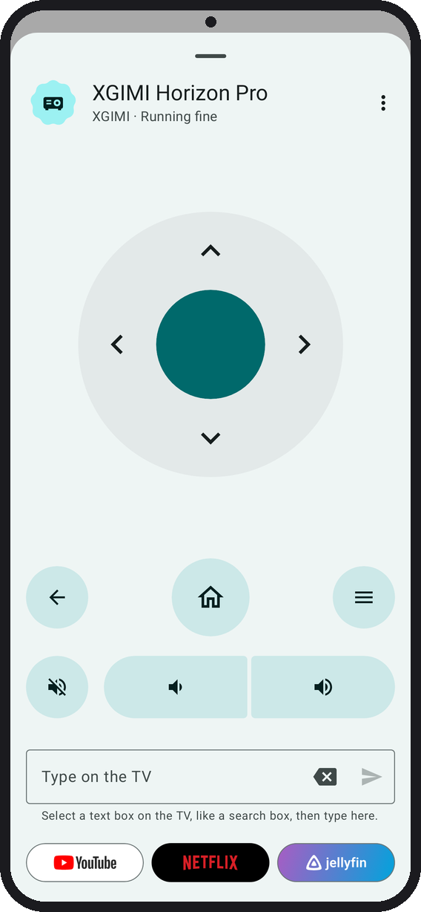
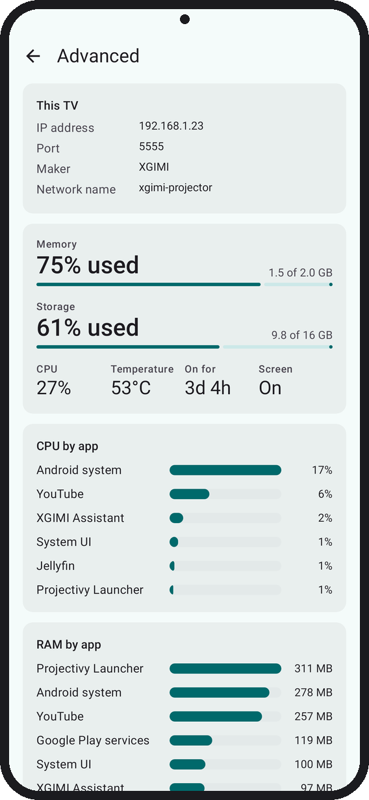

#  Tellyscope

Debloat your Android TV, install apps, and browse and transfer files on it, all from your phone. No root, no PC.

<p>
  
  
  
  
  
  <a href="../../releases/latest"></a>
</p>

<a href="../../releases/latest"></a>
<a href="https://apps.obtainium.imranr.dev/redirect?r=obtainium://add/https://github.com/man15h/tellyscope"></a>
<a href="https://rookieenough.github.io/Orion-Data/redirect.html?id=tellyscope&icon=https%3A%2F%2Fraw.githubusercontent.com%2Fman15h%2Ftellyscope%2Fmain%2Fdocs%2Flogo%2Ficon.svg"></a>

[](https://youtu.be/N_PeDw5GiCc)

<table>
  <tr>
    <td width="25%"></td>
    <td width="25%"></td>
    <td width="25%"></td>
    <td width="25%"></td>
  </tr>
  <tr>
    <td align="center"><sub>Your TV at a glance</sub></td>
    <td align="center"><sub>Control the TV from your phone</sub></td>
    <td align="center"><sub>Review every app Debloat turns off</sub></td>
    <td align="center"><sub>Install apps</sub></td>
  </tr>
  <tr>
    <td></td>
    <td></td>
    <td></td>
    <td></td>
  </tr>
  <tr>
    <td align="center"><sub>Send files to the TV</sub></td>
    <td align="center"><sub>Block ads, tweak the TV, add a launcher</sub></td>
    <td align="center"><sub>Make a launcher Home</sub></td>
    <td align="center"><sub>Advanced monitor: what is using the CPU, RAM and network</sub></td>
  </tr>
</table>

<sub>Rendered from the app's screenshot tests with sample data. The Install dialog is drawn to match the app, and Advanced monitor joins parts of its longer page.</sub>

## What it does

Tellyscope talks to your Android TV, Google TV, NVIDIA Shield or Fire TV over Wi-Fi using ADB, the debugging protocol developers use. Tested on Fire TV (Fire OS 8); a few remote keys don't work there yet. NVIDIA Shield hasn't been tested on real hardware yet.

- **Connect.** Finds TVs on your Wi-Fi, looking again every 10 seconds or when you tap **Rescan**, or add one by IP. Works with network debugging and with Android 11+ wireless debugging and its pairing code. TVs reconnect by themselves.
- **See how it's doing.** Free space, CPU, RAM and network speed, plus what's paired or plugged in. **Advanced monitor** has CPU and RAM by app, processes, network and data used.
- **Debloat.** Matches your TV to one of 330+ tested lists (adapted from [cleanyourtv](https://github.com/Gathin23/cleanyourtv)) and shows every app it will turn off before it does. Untick anything you use, or a whole group from its heading, then watch each app turn off. No list for your model? Pick from the maker's lists, or by hand.
- **Apps.** See what's running and what's on the TV. Turn off apps you don't want, turn them back on any time, and uninstall the ones you added yourself.
- **Install apps.** From an APK, split APKs or an `.apks`/`.xapk`/`.apkm` bundle on your phone; the picker opens in Downloads and shows only apps. It says first whether it's new, an update or an older version.
- **A better home screen.** Install Projectivy or FLauncher and make it Home. Android TV installs it from the TV's Play Store, or Projectivy can be downloaded directly after a warning. Fire TV has no Play Store, so Tellyscope downloads Projectivy from its developer's GitHub releases and installs it only if its signature matches. Switch between launchers, or back to the TV's own, from the Home screen card in Tweaks; only the TV's own is ever turned off. A launcher's accessibility service turns on only if you say yes.
- **Send files.** To and from the TV's Download and Movies folders.
- **Remote.** D-pad, Back, Home, Menu, mute and volume, typing on the TV, buttons that open Netflix, YouTube, Plex and 20 more streaming apps (hold one to pick up to three), restart the TV, and **Screen off** for music with the picture off (Android 13 or older).
- **Reset TV.** In ⋮: turn the TV back to how it shipped, with one Undo. Preinstalled apps come back on, uninstalled ones too, and the TV's own launcher is Home again; apps the maker shipped off stay off.
- **Tweaks.** Block ads with Private DNS, faster animations, clear caches, take a screenshot.
- **Who has access.** See every computer the TV allows over ADB, remove all but this phone, and answer the TV's "Allow debugging?" prompt from your phone.


<sub>A TV after Tellyscope.</sub>

## Languages

English, Español, 简体中文, 日本語, Русский and हिन्दी.

- Tellyscope follows your phone's language. On Android 13 or newer you can also pick one just for Tellyscope in **Settings → Apps → Tellyscope → Language**.
- The translations are machine-made. Corrections are welcome as a PR to `app/src/main/res/values-<lang>/strings.xml`.

## Safety rules

Debloating a TV can break it if done carelessly. Tellyscope keeps to these rules, and contributions must too:

1. **Disable, never uninstall, what came with the TV.** Built-in apps get `pm disable-user`, which Undo or `pm enable` reverses. Uninstall is offered only for apps you installed (`pm list packages -3`), after a confirm. Tellyscope never runs `pm uninstall --user 0`.
2. **Record before changing.** Before its first change on a TV, Tellyscope notes which apps were already off. Every change goes into that TV's History with an Undo (except uninstalls), and **Restore everything** turns back on only what Tellyscope turned off.
3. **Protected list.** Apps the TV needs to boot, update, stay on Wi-Fi, show web pages, show its home screen or take input can't be stopped or disabled, with no override. A TV's list can only add warnings, never remove protection. When you switch home screens, the old launcher is turned off only after Home is checked to open the new one.
4. **You see it first.** Every change names the apps it touches and asks before it runs.
5. **No root, no exploits.** Only what ADB allows on a stock TV.
6. **Nothing left on the TV.** Two small helpers run from `/data/local/tmp`: one reads app names and icons and is deleted at once, the other runs the Remote and is deleted when the Remote closes.
7. **Private.** No ads, tracking or accounts. The only internet requests fetch the shared lists from GitHub (debloat lists, launchers, app names and streaming services with their logos, or [your own fork](CONTRIBUTING.md#using-your-own-lists)), check for a new version every 30 minutes, which you can turn off in Settings, and download Projectivy from its developer's GitHub releases when you ask for it. Everything else stays on your Wi-Fi, except the DNS lookup of each TV's name during the scan.

## Get it

- **[GitHub Releases](../../releases/latest):** download `Tellyscope-<version>.apk` and open it on your phone. `-alpha` pre-releases are test builds that install next to the regular app.
- **[Obtainium](https://github.com/ImranR98/Obtainium)** or **[Orion Store](https://github.com/RookieEnough/Orion-Store):** tap the badge above on your phone for automatic updates.

You need a phone on Android 8.0 or newer, on the same Wi-Fi as the TV.

## Setting up your TV

1. On the TV, open **About** in Settings and press OK on **Build** (Fire TV: your device's name) 7 times.
2. In **Developer options**, turn on **USB debugging** (Fire TV: **ADB debugging**), and **Network debugging** or **Wireless debugging** if your TV lists it.
3. Open Tellyscope, pick your TV's brand under **Add your TV**, and tap **Connect** when your TV shows up. The app shows the exact menu names for your brand.
4. On the TV, check the key matches the one Tellyscope shows, tick **Always allow from this computer** and press **Allow**. With wireless debugging, type the 6-digit pairing code instead.

## Building

Modules: `:app` (the phone app, Kotlin and Jetpack Compose), `:adb` (pure Kotlin ADB library on [Kadb](https://github.com/flyfishxu/Kadb)), `app/src/helper` (the on-TV label helper) and `:cli` (a desktop smoke test, not shipped). You need JDK 25 and the Android SDK with platform 37.

```sh
./gradlew build          # assemble, unit tests and lint
./gradlew :app:installDebug
```

## Contributing

See [CONTRIBUTING.md](CONTRIBUTING.md). If you have an Android TV, a [device report](../../issues/new?template=device_report.yml) helps even if nothing worked.

## Why the name?

In Wallace & Gromit's 2002 short [The Tellyscope](https://wallaceandgromit.fandom.com/wiki/The_Tellyscope), Wallace builds a contraption so he can change the channel without leaving his armchair.

## Star History

<a href="https://www.star-history.com/#man15h/tellyscope&Date">
  
</a>

## License

[GNU General Public License v3.0](LICENSE). Third-party credits are in [NOTICE](NOTICE).
